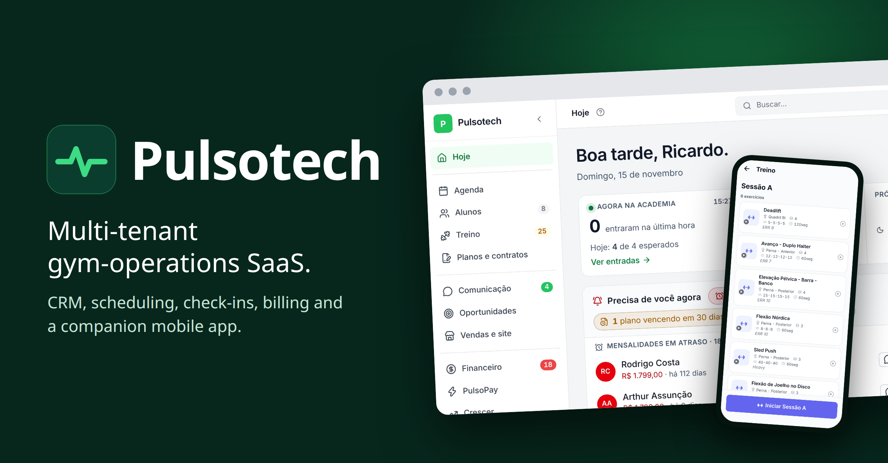
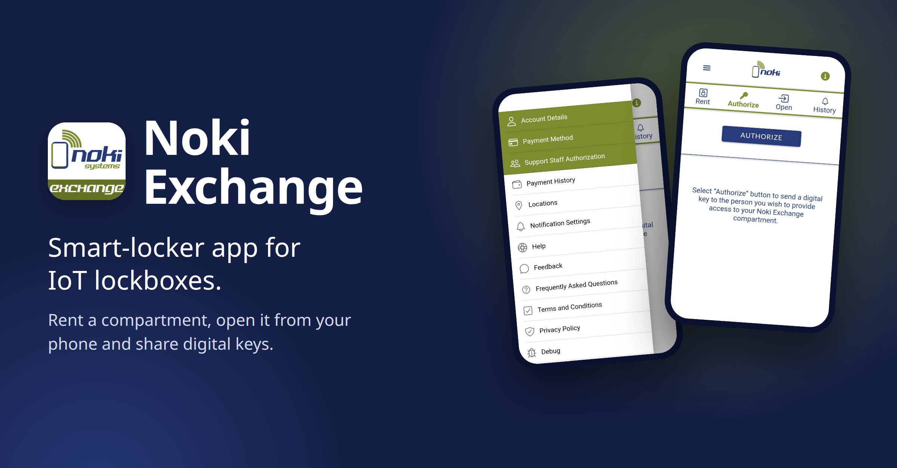

# Daniel Lacaz Ruiz

Full-stack engineer building SaaS products from scratch: **Python / Django**, **Vue & React**, **React Native**, **AWS**.
Co-founder and lead engineer at **Pulsotech**. Canadian, EU and Brazilian citizen based in Brazil · native English, French and Portuguese.

## Selected work

<table>
  <tr>
    <td width="50%" valign="top">
       
      <b>Pulsotech</b>: all-in-one management platform for gyms. Co-founder and sole engineer: members, scheduling, billing, sales pipeline, owner dashboards and an offline-capable phone app.
    </td>
    <td width="50%" valign="top">
       
      <b>ZunaChat</b>: WhatsApp + Instagram customer-communication platform. Led a two-developer team from zero to production in six months: live inbox, no-code automation builder, CRM and broadcasts.
    </td>
  </tr>
  <tr>
    <td width="50%" valign="top">
       
      <b>Aligna</b>: posture-screening app for a spine clinic. Trained the model that places body points from one photo and runs it entirely on the phone: no account, no upload, works offline.
    </td>
    <td width="50%" valign="top">
       
      <b>Pivott</b>: contract and vendor management for multifamily property managers. Core engineer on the zero-to-production build; owned spend management and the reminders engine.
    </td>
  </tr>
  <tr>
    <td width="50%" valign="top">
       
      <b>Noki Exchange</b>: smart-locker app for IoT lockboxes. Built the mobile app independently, plus the backend, recurring payments and the admin and support dashboards.
    </td>
    <td width="50%"></td>
  </tr>
</table>

Most of this code belongs to clients or my company and isn't public. Happy to walk through any of it.

[LinkedIn](https://www.linkedin.com/in/daniel-lacaz-ruiz/) · [About me](https://danlruiz.github.io/about-me/)
